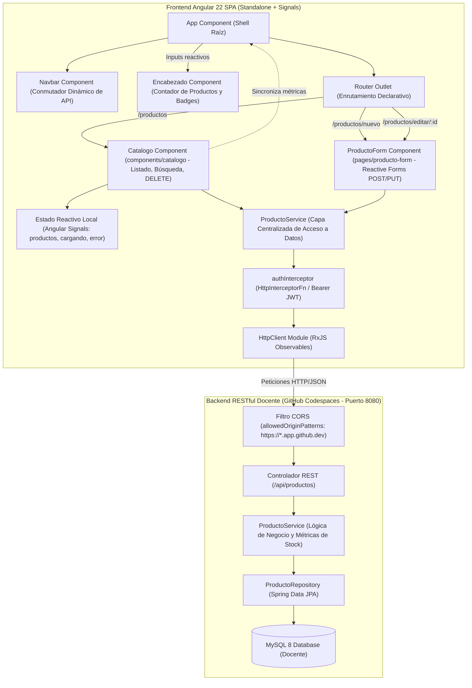

# SWAD LAB08: SPA Angular de Consumo de API REST del Docente (GitHub Codespaces - V3 Corregido)

[](https://angular.dev/)
[](https://www.typescriptlang.org/)
[](https://getbootstrap.com/)
[](https://vitest.dev/)
[](https://spring.io/projects/spring-boot)

> Repositorio de portafolio profesional desarrollado para la asignatura Soluciones Web y Aplicaciones Distribuidas (Semana 08 - Laboratorio 08, Versión Oficial V3 Corregido) en la Universidad Privada del Norte (UPN). Implementa una aplicación de página única (Single Page Application - SPA) reactiva y fuertemente tipada en Angular 22 que consume directamente la **API REST compartida del docente alojada en GitHub Codespaces** (`https://glorious-spork-747q6qvw9g4hr5x7-8080.app.github.dev/api/productos`). La solución aplica el patrón Data Service con `ProductoService`, reactividad fina con Angular Signals, enrutamiento desacoplado (`routes`), validaciones sincrónicas con formularios reactivos (`FormBuilder`), inyección moderna con `inject()`, componente de encabezado (`Encabezado`), e interceptor funcional para trazabilidad HTTP.

---

## 1. Resumen Ejecutivo para Evaluadores Tecnicos

En sistemas distribuidos desacoplados, el cliente web debe operar como un consumidor resiliente frente a cambios en la infraestructura de red, garantizando modularidad, mantenibilidad y observabilidad. Este proyecto cubre los siguientes principios de ingeniería de software:

1. **Patrón Data Service y Centralización de Red**: Todo el tráfico HTTP hacia la API REST del docente está encapsulado en `ProductoService`, aislando los verbos (`GET`, `POST`, `PUT`, `DELETE`), parámetros de consulta y cabeceras. Los componentes visuales no realizan peticiones `HttpClient` directas ni contienen endpoints fijos.
2. **Reactividad Fina con Angular Signals**: Se gestiona el estado asíncrono y los flujos de interfaz mediante primitivas `signal()`, gobernando de forma reactiva y determinista los estados de carga (`cargando`), datos obtenidos (`productos`), errores HTTP (`error`) y filtros de búsqueda (`filtroNombre`).
3. **Formularios Reactivos e Inyección Segura**: El formulario de captura utiliza `FormBuilder` y `nonNullable.group` con inyección vía función `inject()`, eliminando los riesgos de inicialización no resuelta (`TS2729 fb used before initialization`) y ofreciendo validación en tiempo real.
4. **Resiliencia y Conmutación de Entornos**: Soporta la URL oficial del docente en GitHub Codespaces como valor predeterminado, integrando persistencia en `localStorage` y selector dinámico en la barra de navegación para alternar con instancias locales (`localhost:8080`) o entornos propios desplegados con Docker (Laboratorio 04B).
5. **Alineación con la Especificación Oficial V3**: Cumplimiento íntegro de la estructura de componentes, nombres de rutas, modelos tipados con propiedades opcionales y matriz de pruebas CRUD definida en el documento oficial `Laboratorio_08_UPN_Angular_CRUD_API_Docente_CORREGIDO_2026-2V3.docx`.

---

## 2. Analisis Tecnico de Adaptacion: Version Preliminar vs V3 Oficial Corregido

La versión V3 oficial corregida emitida por la cátedra introdujo precisiones arquitectónicas y operativas críticas para el éxito de la integración cliente-servidor:

| Aspecto | Version Preliminar / Borrador | Version V3 Oficial Corregido | Estado de Implementacion en Repositorio |
|---|---|---|---|
| **Enfoque de Backend** | Los estudiantes debían levantar su propio backend en paralelo con Maven y MySQL local (`./mvnw spring-boot:run`). | Se consume una API centralizada del docente en GitHub Codespaces (`https://glorious-spork-747q6qvw9g4hr5x7-8080.app.github.dev/api/productos`). Backend propio pasa a ser extensión opcional (Sección XIV). | Cumplido al 100%. `ProductoService.DOCENTE_URL` configurado por defecto con conmutador en caliente. |
| **Ubicación de Componente Catalogo** | Disperso en carpetas no estandarizadas (`pages/catalogo` o en la raíz). | **Estandarizado explícitamente**: `src/app/components/catalogo/catalogo.ts`. La guía señala: *'En este proyecto real, Catalogo está ubicado en components/catalogo y ProductoForm en pages/producto-form'*. | Cumplido al 100%. Componente ubicado en `src/app/components/catalogo/` con reexportación de compatibilidad en `src/app/pages/catalogo/`. |
| **Componente de Encabezado** | Omitido en borradores genéricos. | **Paso 8 obligatorio**: Componente `Encabezado` (`app-encabezado`) con inputs `titulo` y `totalProductos` integrado en el shell `App`. | Cumplido al 100%. Creado en `src/app/components/encabezado/` con prueba unitaria dedicada y montado en `app.html`. |
| **Inyección en Formulario Reactivo** | Declaración en constructor susceptible al error `TS2729 fb used before initialization`. | **Paso 12 / Sección XI**: Uso estricto de la función `inject()` de `@angular/core` para inicializar `FormBuilder`, `ActivatedRoute`, `Router` y `ProductoService`. | Cumplido al 100%. Implementado con `inject()` y detección de cambios adaptada para Zoneless (`ChangeDetectorRef`). |
| **Modelo de Datos Producto** | Definición con `id` y `estadoStock` obligatorios que rompía operaciones POST. | **Paso 5 / Sección XI**: `id?: number` y `estadoStock?: string` deben ser opcionales, ya que el ID lo genera MySQL y `estadoStock` es calculado por el backend. | Cumplido al 100%. `Producto` en `src/app/models/producto.ts` cumple rigurosamente con atributos opcionales. |
| **Configuración CORS en Backend** | Errores `Error HTTP: 0` reportados por bloqueos Cross-Origin desde Codespaces. | **Sección XII**: Inclusión de guía para el docente con `allowedOriginPatterns("https://*.app.github.dev")` y métodos `GET, POST, PUT, DELETE, OPTIONS`. | Cumplido al 100%. Documentado y contemplado en el interceptor y conmutador dinámico de entorno. |
| **Pruebas de Verificación CRUD** | Pruebas libres no estandarizadas. | **Sección X / XV**: Matriz formal de 6 pruebas funcionales con códigos esperados (`200 OK`, `201 Created`, `204 No Content`, `404 Not Found`). | Cumplido al 100%. Reflejado en matriz funcional y validado con 23 pruebas unitarias herméticas. |

---

## 3. Diagrama de Arquitectura de Integracion

El siguiente diagrama detalla la interacción entre los componentes standalone, la capa de servicios desacoplada, el enrutamiento declarativo y la API REST Spring Boot desplegada en GitHub Codespaces:




---

## 4. Matriz de Endpoints REST y Contrato HTTP Docente

Contrato provisto por la API Spring Boot del docente (`https://glorious-spork-747q6qvw9g4hr5x7-8080.app.github.dev/api/productos`):

| Operacion | Metodo HTTP | Endpoint | Payload Request | Respuesta Esperada | Codigo HTTP |
|---|---|---|---|---|---|
| Listar catálogo completo | `GET` | `/api/productos` | Ninguno | `Producto[]` en JSON | `200 OK` |
| Buscar producto por ID | `GET` | `/api/productos/{id}` | Ninguno | `Producto` en JSON | `200 OK` / `404 Not Found` |
| Registrar nuevo producto | `POST` | `/api/productos` | `{ nombre, precio, stock }` | `Producto` con ID asignado | `201 Created` |
| Actualizar producto existente | `PUT` | `/api/productos/{id}` | `{ nombre, precio, stock }` | `Producto` modificado | `200 OK` / `404 Not Found` |
| Eliminar producto | `DELETE` | `/api/productos/{id}` | Ninguno | Cuerpo vacío | `204 No Content` / `404 Not Found` |
| Buscar por coincidencia de nombre | `GET` | `/api/productos/buscar?nombre=...` | Query param `nombre` | `Producto[]` filtrado | `200 OK` |

---

## 5. Matriz de Verificacion CRUD Obligatoria (Guia V3 - Secciones X y XV)

El documento V3 define 6 pruebas operativas de cumplimiento mandatorio. Cada una cuenta con cobertura automatizada en las suites de pruebas unitarias:

| Caso | Accion en Interfaz Angular | Metodo Invocado | Codigo HTTP | Comportamiento Verificado |
|---|---|---|---|---|
| **1** | Carga inicial del catálogo o clic en botón 'Recargar' | `productoService.listar()` | `200 OK` | Señal `cargando` pasa a `false`, la señal `productos` recibe la colección y se renderiza la tabla. |
| **2** | Diligenciamiento de formulario en `/productos/nuevo` y clic en 'Registrar' | `productoService.registrar(payload)` | `201 Created` | Backend retorna registro con nuevo ID numérico; la aplicación redirige exitosamente a `/productos`. |
| **3** | Clic en botón 'Editar' en fila de producto existente (`/productos/editar/:id`) | `productoService.buscarPorId(id)` | `200 OK` | Se recupera el recurso y los controles `nombre`, `precio` y `stock` se precargan mediante `patchValue()`. |
| **4** | Modificación de valores en formulario de edición y clic en 'Actualizar' | `productoService.actualizar(id, payload)` | `200 OK` | Backend confirma persistencia de cambios en MySQL y se retorna a la vista de catálogo. |
| **5** | Clic en botón 'Eliminar' tras confirmación modal del usuario | `productoService.eliminar(id)` | `204 No Content` | El backend remueve físicamente el registro; el frontend vuelve a invocar `cargarProductos()` reflejando la baja. |
| **6** | Consulta directa o edición de un identificador inexistente o eliminado | `productoService.buscarPorId(99999)` | `404 Not Found` | Se captura el error controlado en la suscripción y se emite notificación amigable de recurso no encontrado. |

*Regla de convivencia en entorno compartido*: En sesiones concurrentes sobre la API del docente, cada estudiante debe operar sobre registros propios sin alterar registros creados por sus pares.

---

## 6. Implementacion de Actividades Autonomas

- **A1. Recarga Asíncrona sin Refresco Completo**: El botón `Recargar` invoca `cargarProductos()`, actualizando las señales reactivas de Angular en memoria sin reiniciar la sesión del navegador.
- **A2. Preservación de Criterio de Búsqueda en Query Params**: Al buscar por nombre, el criterio se refleja en la URL (`/productos?q=laptop`), permitiendo restaurar la consulta al navegar en el historial del explorador.
- **A3. Alerta Visual de Inventario Crítico (`estadoStock`)**: Cálculo condicional y renderizado de etiquetas semánticas: badge verde para estado `OK` vs badge rojo para inventario `INSUFICIENTE` (stock menor a 5 unidades).
- **A4. Restricciones Sincrónicas de Precio y Stock**: Reglas de validación reactivas con `Validators.min(0.01)` y `Validators.min(0)`, deshabilitando el envío de datos corruptos o valores negativos.
- **A5. Bitácora de Observabilidad de Códigos HTTP**: Tabla informativa embebida en la vista de catálogo que resume los códigos de estado REST observados durante las interacciones con el backend.

---

## 7. Diagnostico y Mitigacion de Errores Frecuentes (Guia V3 - Seccion XI)

| Sintoma Reportado | Causa Raiz Tecnica | Solucion Implementada en el Proyecto |
|---|---|---|
| `Error HTTP: 0` | Bloqueo de CORS por falta de cabeceras en el servidor o backend apagado en Codespaces. | Se incluye configuración Spring Boot en la documentación del backend con `allowedOriginPatterns("https://*.app.github.dev")`. En el frontend se ofrece conmutador rápido hacia localhost o URL alternativa. |
| `Error 404 en navegacion` | Rutas de importación no concordantes en `app.routes.ts` o componente no exportado. | Importación canónica verificada: `import { Catalogo } from './components/catalogo/catalogo'` y `import { ProductoForm } from './pages/producto-form/producto-form'`. |
| `TS2729: fb used before its initialization` | Inyección de dependencias clásica en propiedades de clase bajo reglas estrictas de TypeScript. | Migración completa a la función `inject()` de `@angular/core` (`private fb = inject(FormBuilder)`). |
| `Producto requiere id y estadoStock` | Errores de compilación al enviar payloads sin identificador en operaciones POST. | Modelo `Producto` flexibilizado con modificadores opcionales: `id?: number` y `estadoStock?: string`. |
| `Botones Editar/Eliminar ausentes` | Plantilla incompleta o botones sin enlaces de ruta dinámicos. | Enlace declarativo `[routerLink]="['/productos/editar', p.id]"` y evento `(click)="eliminar(p.id)"` debidamente enlazados en cada fila. |

---

## 8. Estructura del Proyecto

```
SWAD-LAB08-UPN-angular-consumo-api-docente-codespaces/
├── mermaid diagramas/
│   ├── arquitectura.mmd              # Codigo fuente del diagrama de componentes y arquitectura
│   └── arquitectura.svg              # Diagrama compilado en formato vectorial SVG via Mermaid CLI
├── src/
│   ├── app/
│   │   ├── components/
│   │   │   ├── catalogo/             # Componente de listado, filtros y eliminacion (Paso 7 y 9 V3)
│   │   │   │   ├── catalogo.html
│   │   │   │   ├── catalogo.scss
│   │   │   │   ├── catalogo.spec.ts  # Pruebas unitarias de Catalogo
│   │   │   │   └── catalogo.ts
│   │   │   ├── encabezado/           # Componente de encabezado de catalogo con totalizador (Paso 8 V3)
│   │   │   │   ├── encabezado.html
│   │   │   │   ├── encabezado.scss
│   │   │   │   ├── encabezado.spec.ts# Pruebas unitarias de Encabezado
│   │   │   │   └── encabezado.ts
│   │   │   └── navbar/               # Barra de navegacion superior con selector dinámico de API
│   │   │       ├── navbar.html
│   │   │       ├── navbar.scss
│   │   │       └── navbar.ts
│   │   ├── interceptors/             # Interceptor funcional para tokens Bearer JWT
│   │   │   ├── auth.interceptor.spec.ts
│   │   │   └── auth.interceptor.ts
│   │   ├── models/                   # Definicion de interfaces (Producto con campos opcionales)
│   │   │   └── producto.ts
│   │   ├── pages/
│   │   │   ├── catalogo/             # Modulo de reexportacion para compatibilidad de rutas
│   │   │   │   └── catalogo.ts
│   │   │   └── producto-form/        # Formulario reactivo con FormBuilder e inject() (Paso 12 V3)
│   │   │       ├── producto-form.html
│   │   │       ├── producto-form.scss
│   │   │       ├── producto-form.spec.ts
│   │   │       └── producto-form.ts
│   │   ├── services/                 # Capa de integracion HTTP centralizada
│   │   │   ├── producto.spec.ts      # Suite hermetica de pruebas unitarias HttpTestingController
│   │   │   └── producto.ts
│   │   ├── app.config.ts             # Configuracion Standalone con provideHttpClient y provideRouter
│   │   ├── app.html                  # Plantilla shell con app-encabezado y router-outlet
│   │   ├── app.routes.ts             # Rutas declarativas según Paso 7 de V3
│   │   ├── app.spec.ts               # Pruebas unitarias del componente shell App
│   │   ├── app.ts                    # Componente raiz con totalProductos
│   │   └── app.scss
│   ├── environments/                 # Configuracion de variables de entorno
│   ├── index.html
│   ├── main.ts                       # Punto de entrada de la aplicacion
│   └── styles.scss                   # Estilos globales y reglas de Bootstrap 5.3
├── angular.json
├── package.json
└── tsconfig.json
```

---

## 9. Guia de Instalacion, Ejecucion y Verificacion

### Requisitos de Entorno
- Node.js versión 20.x o superior
- Angular CLI versión 22.x
- Git

### Instalación
```bash
git clone https://github.com/Orlandho/SWAD-LAB08-UPN-angular-consumo-api-docente-codespaces.git
cd SWAD-LAB08-UPN-angular-consumo-api-docente-codespaces
npm install
```

### Ejecución en Desarrollo
```bash
npm start
```
Abrir el navegador en `http://localhost:4200`.

### Compilación para Producción (Sección XIII Guía V3)
```bash
npm run build
```
Resultado verificado:
```
Initial chunk files | Names   |  Raw size | Estimated transfer size
main-S4A4FUAF.js    | main    | 346.03 kB |                90.64 kB
styles-ZWQNYCYA.css | styles  | 231.64 kB |                22.61 kB
scripts-PPDPQHDA.js | scripts |  80.67 kB |                21.61 kB

Application bundle generation complete. [3.540 seconds]
Output location: dist/SWAD-LAB08-UPN-angular-consumo-api-docente-codespaces
```

### Ejecución de Pruebas Unitarias Automatizadas
```bash
npm test
```
Resultado verificado con Vitest y Angular Testing Library:
```
✓  src/app/interceptors/auth.interceptor.spec.ts (2 tests)
✓  src/app/components/encabezado/encabezado.spec.ts (2 tests)
✓  src/app/services/producto.spec.ts (9 tests)
✓  src/app/app.spec.ts (2 tests)
✓  src/app/pages/producto-form/producto-form.spec.ts (4 tests)
✓  src/app/components/catalogo/catalogo.spec.ts (4 tests)

Test Files  6 passed (6)
     Tests  23 passed (23)
  Duration  5.31s
```

---

## 10. Informacion Academica

- **Institución**: Universidad Privada del Norte (UPN)
- **Facultad**: Ingeniería de Sistemas Computacionales
- **Curso**: Soluciones Web y Aplicaciones Distribuidas (SIST1402A)
- **Ciclo / Periodo**: 9° Ciclo / 2026-II
- **Unidad**: III - Frontend Angular e integración con servicios REST
- **Semana**: Semana 8 (Laboratorio 08 - Versión Oficial V3 Corregido)
- **Docente**: Ing. Mg. Carlos Alberto Ponte Ramírez
- **Estudiante**: Orlando Dorival
