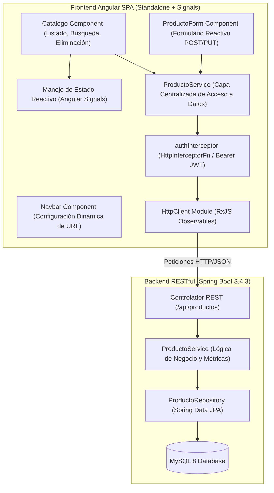

# Enterprise Angular SPA Architecture - HttpClient, Data Service, Signals and Spring Boot Integration (Lab 08)

[](https://angular.dev/)
[](https://www.typescriptlang.org/)
[](https://getbootstrap.com/)
[](https://vitest.dev/)
[](https://spring.io/projects/spring-boot)

> Repositorio de portafolio profesional desarrollado para la asignatura Soluciones Web y Aplicaciones Distribuidas (Semana 08 - Laboratorio 08) en la Universidad Privada del Norte (UPN). Implementa una aplicacion de pagina unica (Single Page Application - SPA) de alta fidelidad que consume servicios RESTful de backend desarrollados en Spring Boot, estructurada mediante el patron Data Service con `ProductoService`, gestion reactiva de estado con Angular Signals, enrutamiento desacoplado con parametros de ruta y Query Params, formularios reactivos con validacion rigurosa e interceptor HTTP funcional para autenticacion Bearer.

---

## 1. Resumen Ejecutivo para Evaluadores Tecnicos

En sistemas corporativos modernos desacoplados, el frontend debe actuar como un consumidor resiliente de contratos HTTP, garantizando la separacion estricta de responsabilidades entre la capa de presentacion, el estado reactivo y el transporte de red. Esta solucion aborda las siguientes competencias de arquitectura web:

1. **Patron Data Service y Desacoplamiento de Red**: Centralizacion absoluta del acceso a datos en `ProductoService`, encapsulando URLs base y verbos HTTP (`GET`, `POST`, `PUT`, `DELETE`). Ningun componente visual realiza llamadas directas a `HttpClient` ni hardcodea endpoints.
2. **Reactividad Fina con Angular Signals**: Administracion de estado mediante primitivas reactivas `signal()`, gobernando de forma sincrona y determinista los estados de carga (`cargando`), datos del catalogo (`productos`), criterios de busqueda y retroalimentacion de errores HTTP (`error`).
3. **Formularios Reactivos con Validaciones Robustas**: Captura tipada mediante `FormBuilder` y `nonNullable.group`, aplicando validaciones sincronas (longitud minima, restricciones de rango positivo y precio maximo corporativo), operando de forma dual para creacion y edicion bajo identificador de ruta.
4. **Seguridad y Trazabilidad HTTP**: Manejo exhaustivo de codigos de estado (`200 OK`, `201 Created`, `204 No Content`, `404 Not Found`), interceptor funcional `authInterceptor` para adjuntar tokens Bearer JWT y soporte dinamico de conmutacion de URL de API en tiempo de ejecucion.

---

## 2. Diagrama de Arquitectura de Integracion

El siguiente diagrama ilustra la arquitectura de componentes Standalone en el frontend, el flujo de llamadas HTTP a traves del Data Service y su enlace con la API RESTful de Spring Boot:




---

## 3. Matriz de Operaciones CRUD y Contrato HTTP

| Operacion Angular | Metodo del Servicio | Verbo HTTP | Endpoint REST | Codigo de Respuesta | Comportamiento en Frontend |
|---|---|---|---|---|---|
| Listado de catalogo | `listar()` | `GET` | `/api/productos` | `200 OK` | Actualiza la señal `productos()`, renderiza tabla con badges de `estadoStock` |
| Busqueda por nombre | `buscarPorNombre(q)` | `GET` | `/api/productos/buscar?nombre={q}` | `200 OK` | Filtra en servidor y preserva parametro en la URL (`/productos?q={q}`) |
| Consulta por ID | `buscarPorId(id)` | `GET` | `/api/productos/{id}` | `200 OK` / `404 Not Found` | Carga datos en modo edicion; notifica si el recurso no existe |
| Registro de nuevo producto | `registrar(p)` | `POST` | `/api/productos` | `201 Created` | Envia payload JSON validado, redirige a `/productos` al confirmar creacion |
| Actualizacion de producto | `actualizar(id, p)` | `PUT` | `/api/productos/{id}` | `200 OK` / `404 Not Found` | Modifica atributos existentes y redirige al catalogo |
| Eliminacion de producto | `eliminar(id)` | `DELETE` | `/api/productos/{id}` | `204 No Content` / `404 Not Found` | Solicita confirmacion explicita y recarga el listado tras respuesta 204 |

---

## 4. Implementacion de Actividades Autonomas del Laboratorio

- **A1. Recarga Asincrona sin Refresco de Pagina**: Boton interactivo `Recargar` que invoca `cargarProductos()` actualizando las señales sin recargar el navegador ni perder el contexto de la aplicacion.
- **A2. Preservacion de Filtro en Query Params (`?q=...`)**: La busqueda por nombre sincroniza bidireccionalmente el valor de busqueda con los query parameters del router Angular, permitiendo compartir enlaces filtrados directamente.
- **A3. Diferenciacion Visual de Inventario Critico (`estadoStock`)**: Renderizado condicional de badges de alerta: `OK` en tono verde suave vs `INSUFICIENTE` (stock < 5 unidades) en badge rojo corporativo.
- **A4. Validacion Reactiva de Precios**: El formulario reactivo bloquea la persistencia de productos con precios menores o iguales a cero o superiores a S/ 50,000.00, presentando mensajes de retroalimentacion contextual en la interfaz.

---

## 5. Estructura del Proyecto

```
SWAD-LAB08-angular-product-service-crud-rest/
├── mermaid diagramas/
│   ├── arquitectura.mmd              # Codigo fuente del diagrama de componentes
│   └── arquitectura.svg              # Diagrama compilado en formato vectorial SVG
├── src/
│   ├── app/
│   │   ├── components/navbar/        # Barra de navegacion con conmutador dinamico de API
│   │   ├── interceptors/             # Interceptor funcional para tokens de autenticacion JWT
│   │   ├── models/                   # Modelo tipado de entidad Producto
│   │   ├── pages/
│   │   │   ├── catalogo/             # Vista de listado, busqueda reactiva y eliminacion
│   │   │   └── producto-form/        # Formulario reactivo de alta y edicion por ID
│   │   ├── services/                 # ProductoService centralizado
│   │   ├── app.config.ts             # Configuracion Standalone con provideHttpClient
│   │   ├── app.routes.ts             # Rutas declarativas: catalogo, nuevo y editar/:id
│   │   └── app.ts                    # Shell raiz de la aplicacion
│   ├── environments/                 # Configuraciones de entorno (localhost / cloud)
│   ├── main.ts                       # Entrypoint de arranque de Angular
│   └── styles.scss                   # Estilos globales y reglas Bootstrap
├── angular.json                      # Configuracion de compilacion y test runner
├── package.json                      # Metadatos y scripts de ejecucion
└── tsconfig.json                     # Configuracion estricta de TypeScript 6.0
```

---

## 6. Guia de Ejecucion y Verificacion

### Requisitos Previos
- Node.js version 20 o superior
- Angular CLI version 22
- Backend Spring Boot activo (puerto 8080) o URL de Codespaces

### Instalacion y Despliegue
1. Instalar dependencias del proyecto:
   ```bash
   npm install
   ```
2. Iniciar el servidor de desarrollo local:
   ```bash
   npm start
   ```
3. Acceder en el navegador a: `http://localhost:4200`
4. *(Opcional)* En la barra superior de navegacion, hacer clic en **Cambiar URL** para apuntar dinamicamente a la URL publica de GitHub Codespaces generada en el Laboratorio 04B.

### Compilacion para Produccion
Validar que el paquete se compila sin errores de tipado o empaquetado:
```bash
npm run build
```
Resultado verificado: Generacion limpia en el directorio `dist/` en 3.8 segundos.

### Ejecucion de Pruebas Automatizadas
Ejecutar la suite hermetica de pruebas unitarias y de integracion:
```bash
npm test
```
Resultado verificado:
```
Test Files  4 passed (4)
     Tests  14 passed (14)
  Duration  4.68s
```

---

## 7. Informacion Academica
- **Institucion**: Universidad Privada del Norte (UPN)
- **Curso**: Soluciones Web y Aplicaciones Distribuidas (SIST1402A)
- **Periodo**: 2026-II
- **Estudiante**: Orlando Dorival
